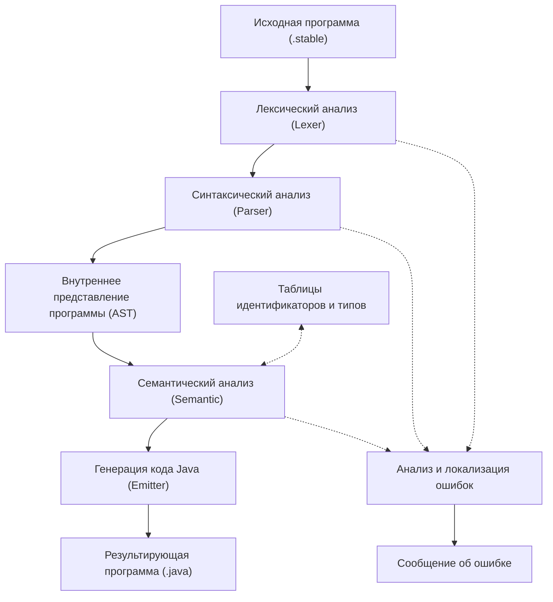

# Схема транслятора языка Stable

Схема соответствует общей структуре транслятора из лекции 4 «Трансляторы», но отражает фактические стадии реализованного Stable → Java.

**Анализ (front-end):** лексический анализ, синтаксический анализ, построение AST и семантический анализ. **Синтез (back-end):** генерация Java-кода из AST с использованием результатов семантического анализа.

**Особенность реализации:** отдельного оптимизатора кода или генератора машинного кода в исходниках нет. Транслятор заканчивает работу созданием `.java`; дальнейший вызов `javac` не входит в схему транслятора.

При обнаружении ошибки выходной Java-файл не создаётся или не заменяется.
